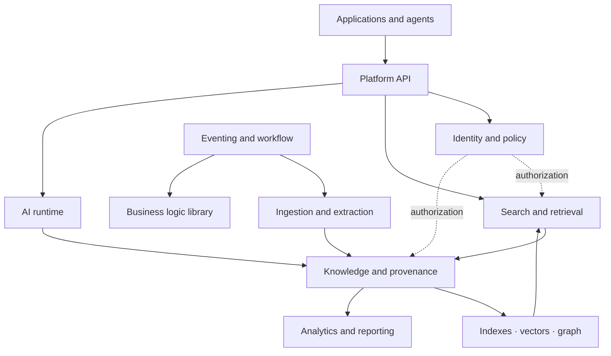
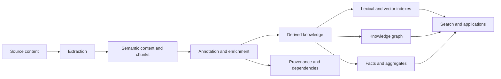
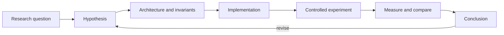

# Synanton

**Open-source systems research for enterprise knowledge and reliable business execution.**

Synanton investigates how enterprise information can become **structured, security-aware, provenance-aware, continuously recalculable knowledge**—and how that knowledge can support reasoning, planning, and dependable action.

> From information to derived knowledge; from knowledge to reliable action.

Synanton is both a software platform and an engineering-research project. We make architectural hypotheses explicit, implement them in open-source components, and evaluate them through reproducible experiments where possible.

**Start here:** [Synanton Guides](https://synanton.github.io/guides/) · [Platform](https://github.com/synanton/platform) · [Roadmap](https://github.com/synanton/.github/blob/main/profile/ROADMAP.md)

---

## What we are investigating

Enterprise knowledge systems must handle several connected problems without hiding them inside one application:

- Heterogeneous content, extraction, semantic interpretation, and enrichment.
- Provenance and traceability from derived facts back to sources and processing runs.
- Security boundaries that survive chunking, embeddings, graph construction, and other transformations.
- Incremental recalculation when sources, models, rules, or policies change.
- Search, vector retrieval, graph reasoning, and analytics over consistent knowledge.
- Multi-tenant resource isolation, fair scheduling, durable execution, and recovery.

The central hypothesis is:

**Knowledge is derived state; analytics is derived state over knowledge and platform activity.**

Search indexes, vectors, graphs, and reports should therefore be rebuildable projections of authoritative inputs—not competing sources of truth.

## Architecture at a glance

Synanton separates concerns into explicit planes with replaceable implementations and defined contracts. This is an architectural direction, not a claim that every component or integration is production-complete.

The key separation is between **source content**, **interpreted knowledge**, **derived projections**, **authorization**, and **measurement**. When inputs or policies change, the goal is to recalculate affected derived state instead of blindly rebuilding everything.

For the integrated design, see [Synanton Platform Architecture 1.0](https://github.com/synanton/platform/blob/main/docs/architecture/synanton-platform-architecture-1.0.md).

## Knowledge lifecycle

Provenance, dependencies, and security classification are lifecycle concerns, not optional metadata added at the end. Design 1.25 is normative for annotation, derived knowledge, dependency-aware recalculation, analytics, and reporting within the current design set; the security and representation model is described in Design 1.23.

## Projects

### Knowledge platform

| Project | Role |
|---|---|
| [**platform**](https://github.com/synanton/platform) | AI-native enterprise knowledge platform: ingestion, hybrid retrieval, knowledge graphs, ontology, enrichment, security-aware processing, agent interfaces, and analytics |
| [**lucentrix**](https://github.com/synanton/lucentrix) | Pluggable source-ingestion and connector infrastructure |
| [**content_extractor**](https://github.com/synanton/content_extractor) | Content extraction capabilities |
| [**content-service**](https://github.com/synanton/content-service) | Content-related service implementation |

### Business logic library

These components investigate how business intent can be turned into controlled distributed execution. They are independent projects and can be adopted separately.

| Project | Responsibility |
|---|---|
| [**resolutor**](https://github.com/synanton/resolutor) | Dependency analysis, conflict resolution, and immutable execution planning |
| [**equalix**](https://github.com/synanton/equalix) | Resource-aware, eventually-fair scheduling |
| [**commitix**](https://github.com/synanton/commitix) | Durable execution intent, persistence, and recovery |

### Supporting infrastructure

- [**equalix-go**](https://github.com/synanton/equalix-go) and [**equalix-micronaut**](https://github.com/synanton/equalix-micronaut) explore the scheduling semantics across different implementation/runtime choices.
- [**gpu-runtime**](https://github.com/synanton/gpu-runtime) investigates isolated GPU execution infrastructure.
- [**security-provider**](https://github.com/synanton/security-provider) and [**adaptive-intelligence**](https://github.com/synanton/adaptive-intelligence) support ongoing security and intelligence research.

See the [Synanton organization](https://github.com/synanton) for the broader repository list and each repository for its implementation status.

## Research method

We distinguish three kinds of statements:

- **Designed** — an architecture or contract is specified.
- **Implemented** — code exists; completeness and maturity are repository-specific.
- **Measured** — evidence is available from a documented experiment.

A design document is not proof of implementation, and an implementation is not proof that its hypothesis holds. The [Roadmap](https://github.com/synanton/.github/blob/main/profile/ROADMAP.md) tracks current priorities; repository documentation remains authoritative for component-level status.

## Evidence and evaluations

Research claims should be backed by published workloads, metrics, and limitations.

### Retrieval benchmark

The platform's retrieval evaluation compares multiple vector backends and hybrid reciprocal-rank fusion (RRF) across different corpora. Results are corpus-dependent:

- **Demo corpus** (16 documents, 28 human-confirmed queries): PG/YDB scored 0.9821; Lucene-hybrid 0.92; Milvus/Qdrant 0.85–0.88; Lucene standalone 0.80–0.83.
- **RAG-Multi-Corpus** (236 synthetic enterprise documents, 1,216 upstream gold queries): Lucene-hybrid scored 0.9778; Milvus/Qdrant 0.9572; Lucene standalone 0.9490; PG/YDB 0.7944.
- Service integration added no measured distortion in this pass. The engine ranking changed by corpus, and blind rank fusion could bury single-leg hits.

Evidence and methodology: [Vector engine selection (ADR-013)](https://github.com/synanton/platform/blob/main/docs/architecture/vector-engine-selection.md) · [Benchmark tracker](https://github.com/synanton/platform/blob/main/docs/implementation/benchmark-tracker.md) · [Dataset registry](https://github.com/synanton/platform/blob/main/docs/benchmark/datasets.md).

### Equalix implementation-family comparison

The [Equalix family comparison](https://github.com/synanton/.github/blob/main/profile/experiments/equalix-family-comparison.md) compares the Spring Boot reference, Go reimplementation, and Micronaut port under the same weighted-fair scheduling semantics. Its reported result is bounded: Micronaut's AOT compilation improved cold start and image size, but runtime metrics overlapped within measurement noise; Go showed a distinct native-binary runtime profile.

These evaluations are specific to their documented workloads. They should not be generalized beyond the conditions measured.

## Research areas

| Area | Question |
|---|---|
| Knowledge representation | How should heterogeneous enterprise content become durable, addressable knowledge? |
| Semantic chunking | Which chunk boundaries remain stable across retrieval, security, provenance, and downstream processing? |
| Incremental recalculation | Can changes to sources, rules, models, or policies update only affected derived state? |
| Provenance | Can every derived result be traced to sources, definitions, producers, runs, and dependencies? |
| Secure semantic search | How can useful semantic representations avoid leaking sensitive information? |
| GraphRAG | When do explicit relationships and graph traversal improve retrieval and reasoning? |
| Analytics over knowledge | Can analytics remain a rebuildable projection rather than another source of truth? |
| Fair scheduling | Can multi-tenant workloads receive predictable resources without starvation? |
| Durable execution | Can business intent survive process, node, and infrastructure failures? |
| Agent interfaces | What guarantees are needed when enterprise knowledge and actions are exposed to AI agents? |

## Design principles

- Make architectural boundaries and contracts explicit.
- Keep business semantics independent of infrastructure.
- Prefer composable components and replaceable implementations.
- Design for failure, recovery, and change.
- Treat derived state as derived state.
- Preserve provenance across transformations.
- Make security a property of the data lifecycle.
- State guarantees precisely and measure assumptions rather than relying on intuition.

## Documentation

| Audience | Resource |
|---|---|
| General and non-code-oriented readers | [Synanton Guides](https://synanton.github.io/guides/) |
| Platform architecture and contracts | [Architecture docs](https://github.com/synanton/platform/tree/main/docs/architecture) |
| Implementation and benchmark tracking | [Implementation docs](https://github.com/synanton/platform/tree/main/docs/implementation) |
| API consumers | [API docs](https://github.com/synanton/platform/tree/main/docs/api) |
| Operators and SREs | [Operations docs](https://github.com/synanton/platform/tree/main/docs/operations) |
| Research direction | [Roadmap](https://github.com/synanton/.github/blob/main/profile/ROADMAP.md) |

## Status and contact

Synanton is an actively developed experimental research project. Maturity varies by repository and component; consult each project's documentation before relying on a particular capability.

- **Research and general inquiries:** research@synanton.org
- **Security reports:** security@synanton.org

Each repository specifies its applicable license.
